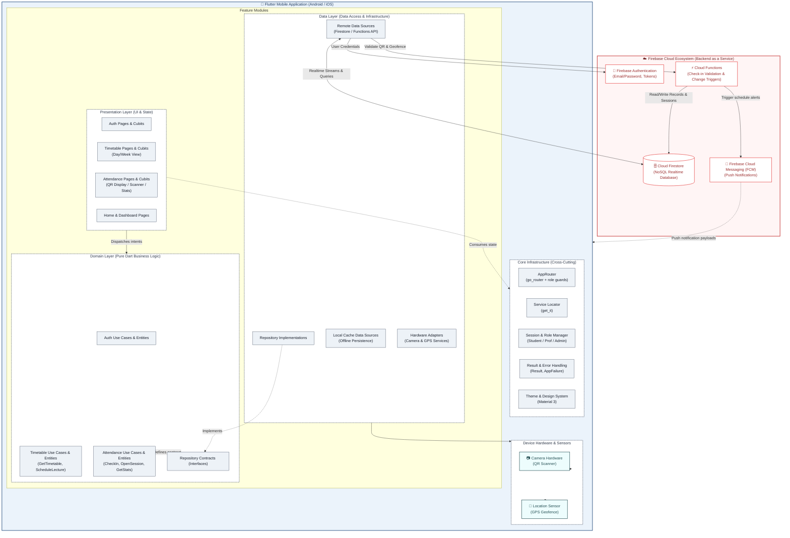
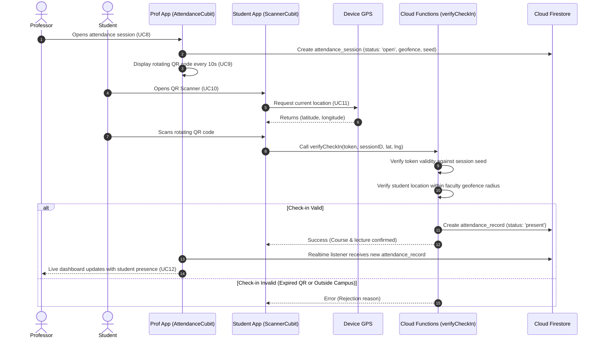
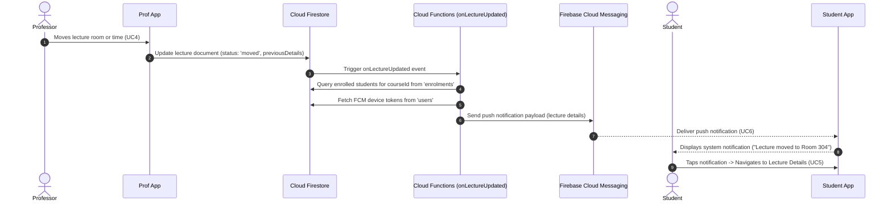

# System Architecture and Component Specification

**Project:** UniConnect (University Timetable & Attendance Mobile Platform)  
**Ticket:** SCRUM-22 (Create architecture / component diagram)  
**Target Platform:** Flutter (Android/iOS) & Google Firebase Backend  
**Document Status:** Complete / Ready for Confluence publication  

---

## 1. Architectural Vision & Design Principles

UniConnect is designed as a distributed, modular, and reactive mobile system. The architecture guarantees high maintainability, testability, and responsiveness under varying network conditions.

### Architectural Principles:
1. **Clean Architecture by Feature**: The Flutter client is partitioned into self-contained feature slices (`auth`, `timetable`, `attendance`, `home`). Each feature is organized into three distinct layers:
   - **Presentation Layer**: UI widgets, views, and state management via BLoC/Cubit.
   - **Domain Layer**: Core enterprise business logic, entities, repository contracts, and use cases (100% pure Dart, decoupled from Flutter and Firebase).
   - **Data Layer**: Implementation of repository contracts, remote/local data sources, and DTO mappers.
2. **Dependency Inversion & Composition Root**: Features never import other features directly. Cross-feature integration, navigation (`go_router`), and dependency injection (`get_it`) are centralized within the `core` module.
3. **Reactive Cloud Backend (Firebase BaaS)**:
   - Real-time data synchronization using **Cloud Firestore**.
   - Serverless event-driven business logic using **Cloud Functions** (verifying rotating QR tokens and geofencing).
   - Targeted push notifications via **Firebase Cloud Messaging (FCM)**.
   - Secure authentication and identity management via **Firebase Auth**.
4. **Resilience & Offline First**: Critical features (such as timetable consultation) rely on local cache persistence to operate without network coverage (UC7).

---

## 2. Overall Component Diagram

The following diagram illustrates the global system architecture: the Flutter client layers, hardware integrations, and the Firebase cloud ecosystem.

---

## 3. Component Breakdown & Responsibilities

### 3.1 Client Layer: Feature Modules & Clean Architecture

Each feature module is organized into three strictly decoupled layers, enforced by automated architecture lint tests:

| Component / Layer | Responsibility | Dependencies & Constraints |
| :--- | :--- | :--- |
| **Presentation Layer** | Renders UI (Widgets, Screens) using Flutter Material 3. Manages UI state and user events using **BLoC / Cubit**. Displays loading indicators, snackbars, and error states. | Depends **only** on the `Domain` layer and `Core`. Strictly forbidden from importing the `Data` layer or Firebase SDK directly. |
| **Domain Layer** | Encapsulates enterprise logic: Entities (e.g. `User`, `Lecture`, `AttendanceSession`), abstract Repository interfaces, and Use Cases (e.g. `ScheduleLecture`, `CheckInWithQrCode`). | **Pure Dart**. Has zero dependencies on Flutter, Firebase, UI, or external SDKs. Completely portable and unit-testable. |
| **Data Layer** | Implements the domain repository contracts. Orchestrates data fetching from remote data sources (Cloud Firestore, Cloud Functions) and local persistent caches. Converts raw JSON/Firestore snapshots into domain entities via DTO models. | Depends on `Domain` and external SDKs (Firebase SDK, Camera, Geolocator). Never leaks external models to the presentation layer. |

---

### 3.2 Client Layer: Core Infrastructure Modules

The `lib/core` directory contains cross-cutting building blocks shared across all features:

* **AppRouter (`core/router`)**:
  - Declarative routing powered by `go_router`.
  - Manages deep linking and role-based route guards (`UserRole: student, professor, admin`).
  - Automatically redirects unauthenticated users to `/login` and routes authenticated users to their specific role dashboard (`/student`, `/professor`, `/admin`).
* **Service Locator (`core/di/injection.dart`)**:
  - Dependency injection container built with `get_it`.
  - Acts as the application's composition root: instantiates and registers data sources, repositories, cubits, and platform services as singletons or factories.
* **Session Manager (`core/session`)**:
  - Maintains the active user identity, authentication state, and role claims throughout the app lifecycle.
* **Result & Error System (`core/result` & `core/error`)**:
  - Functional error handling using a sealed class `Result<T>` (`Success` or `Failure`).
  - Ensures repositories catch all infrastructure exceptions and wrap them into typed `AppFailure` instances. **No uncaught exception ever crashes the UI**.

---

### 3.3 Client Layer: Hardware & Platform Services

* **Camera Subsystem (`DS_HARDWARE / Camera`)**:
  - Integrates device camera hardware to scan rotating QR codes (UC10) using `mobile_scanner`.
* **Geolocation Subsystem (`DS_HARDWARE / GPS`)**:
  - Interacts with device location services (`geolocator`) to capture real-time GPS coordinates $(lat, lng)$ for physical presence validation within the university boundary (UC11).
* **Local Offline Cache (`DS_LOCAL`)**:
  - Leverages Firestore native offline cache and local secure storage to allow students to consult their latest synchronized schedule without active network coverage (UC7).

---

### 3.4 Backend Layer: Firebase Cloud Platform

* **Firebase Authentication (`FB_AUTH`)**:
  - Handles user account credentials, password resets, session tokens, and security claims.
* **Cloud Firestore (`FB_FIRESTORE`)**:
  - Highly scalable, multi-region NoSQL document database.
  - Houses the 6 core collections (`users`, `courses`, `enrolments`, `lectures`, `attendance_sessions`, `attendance_records`).
  - Provides real-time reactive streams (`onSnapshot`) to update student schedules and the professor's live attendance monitor instantly.
* **Firebase Cloud Functions (`FB_FUNCTIONS`)**:
  - Serverless compute environment executing trusted backend operations:
    1. **`verifyCheckIn`**: Validates the cryptographic rotating token seed and calculates the Haversine distance between the student's GPS location and faculty coordinates, preventing fraud.
    2. **`onLectureUpdated`**: Database trigger listening to changes on the `lectures` collection. When a lecture is cancelled or relocated, it automatically gathers affected students and dispatches FCM notifications.
* **Firebase Cloud Messaging (`FB_FCM`)**:
  - Low-latency push notification gateway delivering schedule modification alerts to students' iOS and Android devices in background or terminated states (UC6).

---

## 4. Key End-to-End Interaction Flows

### Flow 1: Attendance Check-in with Rotating QR & Geofence (UC8 to UC11)

### Flow 2: Timetable Reschedule & Push Notification (UC4 & UC6)

---

## 5. Technology Stack & Component Mapping

| Architectural Component | Technology / Library | Layer / Location |
| :--- | :--- | :--- |
| **Mobile Client Framework** | Flutter SDK 3.x (Dart 3.x) | Client Application |
| **UI Design System** | Material 3 Components | `lib/core/theme/` & `presentation/` |
| **State Management** | `flutter_bloc` / Cubit | `lib/features/*/presentation/` |
| **Dependency Injection** | `get_it` | `lib/core/di/injection.dart` |
| **Navigation & Routing** | `go_router` | `lib/core/router/` |
| **QR Code Scanner** | `mobile_scanner` | `lib/features/attendance/data/` |
| **Geolocation & Geofence** | `geolocator` | `lib/features/attendance/data/` |
| **Unit & Architecture Testing**| `flutter_test`, `mocktail`, `bloc_test` | `test/` |
| **User Identity** | Firebase Authentication | Cloud Backend |
| **Realtime Database** | Google Cloud Firestore | Cloud Backend |
| **Serverless Logic** | Firebase Cloud Functions (TypeScript/Node.js) | Cloud Backend |
| **Push Notification Service** | Firebase Cloud Messaging (FCM) | Cloud Backend |
