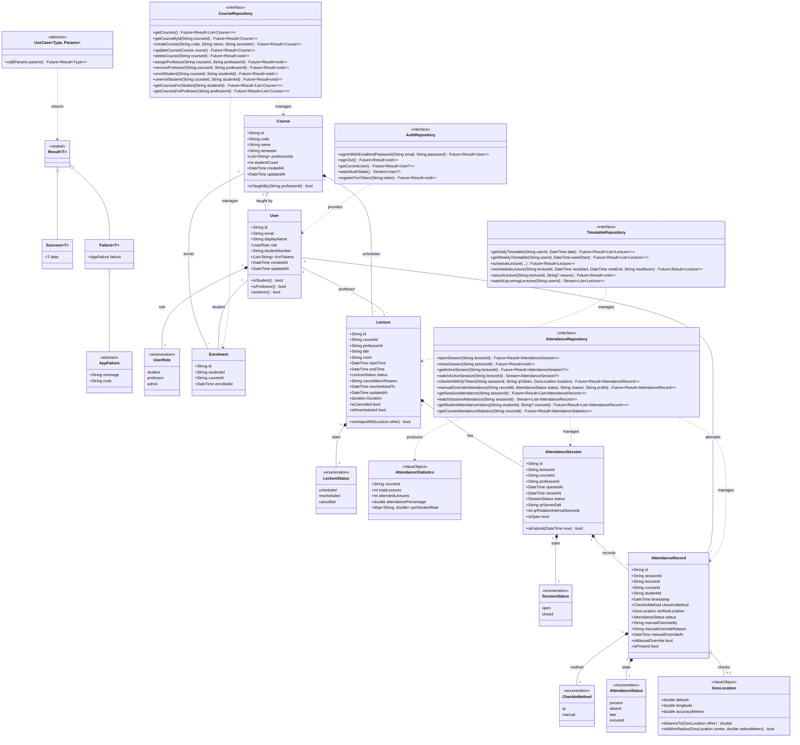

# Domain Model Class Diagram Specification

**Project:** UniConnect (University Timetable & Attendance Mobile Platform)  
**Ticket:** SCRUM-20 (Create class diagram of the domain model)  
**Parent Epic:** SCRUM-6 (Analysis & design (UML))  
**Target Platform:** Pure Dart Domain Layer (Clean Architecture)  
**Document Status:** Complete / Ready for Confluence publication  

---

## 1. Architectural Vision & Context

In accordance with the clean architecture principles defined in **SCRUM-22** (*Component Architecture Specification*) and the storage structures designed in **SCRUM-23** (*Cloud Firestore Data Model*), the **Domain Layer** contains the core business rules and enterprise concepts of the UniConnect platform.

### Key Characteristics of the Domain Layer:
1. **Framework Decoupling (Pure Dart)**: Zero dependencies on Flutter UI components or Firebase SDKs. All entities, interfaces, and logic are platform-agnostic, enabling 100% isolated unit testing and clean maintainability.
2. **Immutability & Value Equality**: Entities and Value Objects leverage immutable state (e.g. `Equatable`), preventing unexpected side effects across asynchronous state transitions.
3. **Explicit Functional Error Handling**: Every repository contract returns a sealed `Result<T>` (`Success<T>` or `Failure<T>`) enclosing an `AppFailure`. No raw exceptions are thrown across domain boundaries.
4. **Behavioral Encapsulation**: Beyond static data fields, entities encapsulate domain validation, business assertions, and convenience predicates (e.g., `overlapsWith`, `isExpired`, `isWithinRadius`).

---

## 2. Complete Domain Model Class Diagram

The diagram below details the entire object-oriented domain layer: entities, value objects, enumerations, repository contracts, and core primitives.

---

## 3. Detailed Entity & Value Object Specifications

### 3.1. Identity & Access Module

#### `User` (Entity)
Represents any authenticated system actor within UniConnect.
- **Attributes**:
  - `id`: Unique user identity string (aligned with Firebase Auth UID).
  - `email`: Institutional email address.
  - `displayName`: Formatted full name of the user.
  - `role`: `UserRole` enum (`student`, `professor`, `admin`).
  - `studentNumber`: Optional student ID (only populated for students).
  - `fcmTokens`: Device registration tokens for Firebase Cloud Messaging alerts.
  - `createdAt`, `updatedAt`: Entity lifecycle timestamps.
- **Methods**:
  - `isStudent()`: Returns `true` if `role == UserRole.student`.
  - `isProfessor()`: Returns `true` if `role == UserRole.professor`.
  - `isAdmin()`: Returns `true` if `role == UserRole.admin`.

---

### 3.2. Timetable & Course Module

#### `Course` (Entity)
Academic subject or unit managed by administrators.
- **Attributes**:
  - `id`: Unique course identifier.
  - `code`: Official course code (e.g. `CS302`).
  - `name`: Descriptive name (e.g. `Mobile Application Development`).
  - `semester`: Academic session (e.g. `2026-FALL`).
  - `professorIds`: List of user UIDs assigned to teach this course.
  - `studentCount`: Number of currently enrolled students.
  - `createdAt`, `updatedAt`: Entity timestamps.
- **Methods**:
  - `isTaughtBy(String professorId)`: Verifies if a given professor is assigned.

#### `Enrolment` (Entity)
Association entity linking a student to an academic course.
- **Attributes**:
  - `id`: Composite identifier `{studentId}_{courseId}` ensuring uniqueness.
  - `studentId`: Foreign key to `User.id`.
  - `courseId`: Foreign key to `Course.id`.
  - `enrolledAt`: Date and time when enrolment was granted.

#### `Lecture` (Entity)
A scheduled classroom session or lecture slot for a course.
- **Attributes**:
  - `id`: Unique lecture identifier.
  - `courseId`: Associated course identifier.
  - `professorId`: Assigned instructor for this session.
  - `title`: Lecture subject or description (e.g. `Clean Architecture Lab`).
  - `room`: Physical or virtual classroom identifier (e.g. `Lab B-104`).
  - `startTime`: Session start time (`DateTime`).
  - `endTime`: Session end time (`DateTime`).
  - `status`: `LectureStatus` (`scheduled`, `rescheduled`, `cancelled`).
  - `cancellationReason`: Optional note explaining cancellation.
  - `rescheduledTo`: New timestamp reference if moved.
  - `updatedAt`: Last change timestamp.
- **Methods**:
  - `duration`: Computes `endTime.difference(startTime)`.
  - `isCancelled`: Returns `status == LectureStatus.cancelled`.
  - `isRescheduled`: Returns `status == LectureStatus.rescheduled`.
  - `overlapsWith(Lecture other)`: Temporal collision check algorithm.

---

### 3.3. Attendance Module

#### `AttendanceSession` (Entity)
An active or concluded attendance window initiated by a professor.
- **Attributes**:
  - `id`: Unique attendance session identifier.
  - `lectureId`: Target lecture identifier.
  - `courseId`: Associated course identifier.
  - `professorId`: Initiating instructor identifier.
  - `openedAt`: Time when session check-ins were allowed.
  - `closedAt`: Time when session was sealed.
  - `status`: `SessionStatus` (`open`, `closed`).
  - `qrSecretSalt`: Rotating HMAC secret salt for dynamic QR token generation.
  - `qrRotationIntervalSeconds`: Token validity duration (default: 10s).
- **Methods**:
  - `isOpen`: Checks whether `status == SessionStatus.open`.
  - `isExpired(DateTime now)`: Checks if current time exceeds allowed closing threshold.

#### `AttendanceRecord` (Entity)
Individual attendance proof logged for a student.
- **Attributes**:
  - `id`: Unique record identifier.
  - `sessionId`: Foreign key to `AttendanceSession.id`.
  - `lectureId`: Associated lecture identifier.
  - `courseId`: Associated course identifier.
  - `studentId`: Foreign key to `User.id`.
  - `timestamp`: Precise check-in timestamp.
  - `checkInMethod`: `CheckInMethod` (`qr`, `manual`).
  - `verifiedLocation`: Optional `GeoLocation` captured at scan time.
  - `status`: `AttendanceStatus` (`present`, `absent`, `late`, `excused`).
  - `manualOverrideBy`: Professor UID if status was manually adjusted.
  - `manualOverrideReason`: Audit explanation for manual alteration.
  - `manualOverrideAt`: Timestamp of manual intervention.
- **Methods**:
  - `isManualOverride`: Returns `true` if `manualOverrideBy != null`.
  - `isPresent`: Returns `status == AttendanceStatus.present`.

#### `GeoLocation` (Value Object)
Represents geographic coordinates for geofencing compliance.
- **Attributes**:
  - `latitude`: WGS84 coordinate.
  - `longitude`: WGS84 coordinate.
  - `accuracyMeters`: Hardware sensor precision metric.
- **Methods**:
  - `distanceTo(GeoLocation other)`: Haversine distance calculation in meters.
  - `isWithinRadius(GeoLocation center, double radiusMeters)`: Geofence boundary check.

#### `AttendanceStatistics` (Value Object / Aggregate)
Consolidated attendance analytics for dashboard consumption.
- **Attributes**:
  - `courseId`: Course identifier.
  - `totalLectures`: Total lecture count held.
  - `attendedLectures`: Total lectures successfully attended.
  - `attendancePercentage`: Computed ratio `(attended / total) * 100`.
  - `perStudentRate`: Mapping of `{ studentId: attendanceRate }`.

---

## 4. Repository Contracts (Domain Interfaces)

Domain interfaces specify contracts implemented by the Data layer (`data/repositories/`).

### 4.1. `AuthRepository`
| Method | Parameters | Return Type | Description |
| :--- | :--- | :--- | :--- |
| `signInWithEmailAndPassword` | `email`, `password` | `Future<Result<User>>` | Authenticates user and fetches profile |
| `signOut` | none | `Future<Result<void>>` | Terminates active session |
| `getCurrentUser` | none | `Future<Result<User?>>` | Reads cached/active user state |
| `watchAuthState` | none | `Stream<User?>` | Real-time authentication state stream |
| `registerFcmToken` | `token` | `Future<Result<void>>` | Registers device token for notifications |

### 4.2. `CourseRepository`
| Method | Parameters | Return Type | Description |
| :--- | :--- | :--- | :--- |
| `getCourses` | none | `Future<Result<List<Course>>>` | Fetches all university courses |
| `getCourseById` | `courseId` | `Future<Result<Course>>` | Retrieves detailed course entity |
| `createCourse` | `code`, `name`, `semester` | `Future<Result<Course>>` | Creates a new course (Admin) |
| `updateCourse` | `course` | `Future<Result<Course>>` | Modifies existing course details |
| `deleteCourse` | `courseId` | `Future<Result<void>>` | Removes course entity |
| `assignProfessor` | `courseId`, `professorId` | `Future<Result<void>>` | Associates teacher with course |
| `removeProfessor` | `courseId`, `professorId` | `Future<Result<void>>` | Detaches teacher from course |
| `enrolStudent` | `courseId`, `studentId` | `Future<Result<void>>` | Enrols student into course |
| `unenrolStudent` | `courseId`, `studentId` | `Future<Result<void>>` | Removes student enrolment |
| `getCoursesForStudent` | `studentId` | `Future<Result<List<Course>>>` | Retrieves enrolled courses |
| `getCoursesForProfessor` | `professorId` | `Future<Result<List<Course>>>` | Retrieves assigned courses |

### 4.3. `TimetableRepository`
| Method | Parameters | Return Type | Description |
| :--- | :--- | :--- | :--- |
| `getDailyTimetable` | `userId`, `date` | `Future<Result<List<Lecture>>>` | Daily schedule consultation (UC5) |
| `getWeeklyTimetable` | `userId`, `weekStart` | `Future<Result<List<Lecture>>>` | Weekly calendar view (UC5) |
| `scheduleLecture` | `courseId`, `profId`, `room`, `start`, `end`, `title` | `Future<Result<Lecture>>` | Schedules new lecture (UC3) |
| `rescheduleLecture` | `lectureId`, `newStart`, `newEnd`, `newRoom` | `Future<Result<Lecture>>` | Modifies session room/time (UC4) |
| `cancelLecture` | `lectureId`, `reason` | `Future<Result<void>>` | Cancels lecture session (UC4) |
| `watchUpcomingLectures`| `userId` | `Stream<List<Lecture>>` | Realtime schedule sync & offline cache |

### 4.4. `AttendanceRepository`
| Method | Parameters | Return Type | Description |
| :--- | :--- | :--- | :--- |
| `openSession` | `lectureId` | `Future<Result<AttendanceSession>>` | Opens live session & QR rotation (UC8) |
| `closeSession` | `sessionId` | `Future<Result<void>>` | Seals session, halts check-ins (UC8) |
| `getActiveSession` | `lectureId` | `Future<Result<AttendanceSession?>>` | Queries currently open session |
| `watchActiveSession` | `lectureId` | `Stream<AttendanceSession?>` | Realtime status of open session |
| `checkInWithQrToken` | `sessionId`, `qrToken`, `location` | `Future<Result<AttendanceRecord>>` | Validates QR and GPS boundary (UC10, UC11) |
| `manualOverrideAttendance` | `recordId`, `status`, `reason`, `profId` | `Future<Result<AttendanceRecord>>` | Teacher correction override (UC12) |
| `getSessionAttendance` | `sessionId` | `Future<Result<List<AttendanceRecord>>>` | Live list of checked-in students (UC12) |
| `watchSessionAttendance`| `sessionId` | `Stream<List<AttendanceRecord>>`| Live stream of student arrivals |
| `getStudentAttendanceHistory` | `studentId`, `courseId` | `Future<Result<List<AttendanceRecord>>>` | Student personal record (UC14) |
| `getCourseAttendanceStatistics`| `courseId` | `Future<Result<AttendanceStatistics>>` | Aggregated attendance metrics (UC13) |

---

## 5. Traceability Matrix: Domain, Firestore & Use Cases

| Domain Entity | Firestore Collection (SCRUM-23) | Component / Layer (SCRUM-22) | Primary Use Cases (SCRUM-19) |
| :--- | :--- | :--- | :--- |
| `User` | `users` | Presentation / Domain / Auth | SCRUM-25, SCRUM-28 |
| `Course` | `courses` | Presentation / Domain / Course | UC1, UC2 (SCRUM-30, SCRUM-31) |
| `Enrolment` | `enrolments` | Data / Domain / Course | UC2 (SCRUM-31) |
| `Lecture` | `lectures` | Timetable Feature | UC3, UC4, UC5, UC6, UC7 (SCRUM-32 to SCRUM-36) |
| `AttendanceSession` | `attendance_sessions` | Attendance Feature | UC8, UC9 (SCRUM-37, SCRUM-38) |
| `AttendanceRecord` | `attendance_records` | Attendance Feature | UC10, UC11, UC12, UC14 (SCRUM-39 to SCRUM-44) |
| `AttendanceStatistics`| Computed Aggregate | Attendance Feature | UC13 (SCRUM-43) |

---

## 6. Source Files

- **PlantUML Model**: `docs/uml/domain-class-diagram.puml`
- **Component Architecture**: `docs/architecture/component-architecture.md`
- **Firestore Schema**: `docs/firestore-data-model.md`
- **Use Cases & Requirements**: `docs/uml/use-case-descriptions.md`
