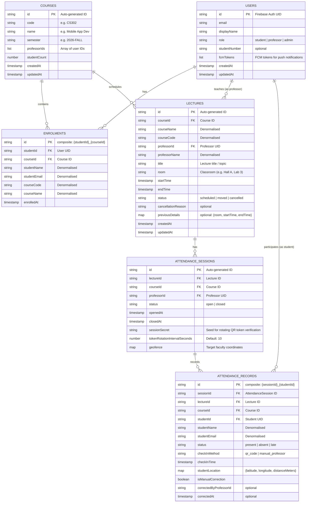

# Cloud Firestore Data Model Specification

**Project:** UniConnect (Mobile App for University Timetable and Attendance)  
**Ticket:** SCRUM-23 (Design the Firestore data model)  
**Target Platform:** Firebase Cloud Firestore (NoSQL Document Store)  
**Document Status:** Complete / Ready for Confluence publication  

---

## 1. Overview & Architectural Principles

UniConnect relies on **Google Cloud Firestore** as its primary cloud database. Firestore is a flexible, scalable NoSQL document database built on collections of JSON-like documents.

### Key Design Principles:
1. **Document-driven & Read-optimized**: Denormalize selectively to support high-frequency queries (e.g. daily/weekly timetable rendering and attendance statistics) with minimal reads.
2. **Subcollection vs. Root Collection**:
   - High-throughput / independent reporting entities (such as `attendance_records`) use a root collection with indexed foreign keys (`sessionId`, `studentId`, `courseId`) to allow cross-course and cross-student aggregation queries (e.g., student overall attendance history).
   - `users`, `courses`, `enrolments`, `lectures`, `attendance_sessions`, and `attendance_records` form the core schema.
3. **Auditability & Status Tracking**: All updates to scheduled lectures (cancellations/reschedulings) and manual teacher attendance overrides track timestamps, reasons, and actors.
4. **Offline Support & Resiliency**: Native Firestore offline persistence caches queries locally (supporting **UC7: View timetable offline**).

---

## 2. Entity-Relationship & Collection Diagram



---

## 3. Detailed Collection Specifications

### 3.1 Collection: `users`
Represents application accounts created via Firebase Authentication.

* **Document ID**: Matches the Firebase Authentication `auth.uid`.

| Field Name | Type | Required | Description |
| :--- | :--- | :---: | :--- |
| `id` | `string` | Yes | Same as Firebase Auth UID |
| `email` | `string` | Yes | Institutional email address |
| `displayName` | `string` | Yes | Full name (Firstname Lastname) |
| `role` | `string` | Yes | Enum: `'student'`, `'professor'`, `'admin'` |
| `studentNumber` | `string` | No | Student ID number (populated if `role == 'student'`) |
| `department` | `string` | No | University department / faculty |
| `fcmTokens` | `array<string>` | No | List of FCM device tokens for push alerts (UC6) |
| `createdAt` | `timestamp` | Yes | Server timestamp of registration |
| `updatedAt` | `timestamp` | Yes | Server timestamp of last profile update |

**Document Example (`users/{uid}`):**
```json
{
  "id": "u4hG92jK1LmN",
  "email": "louis.tournant@edu.ece.fr",
  "displayName": "Louis Tournant",
  "role": "student",
  "studentNumber": "STU-2026-9041",
  "department": "Computer Science & Software Engineering",
  "fcmTokens": ["fcm_token_example_abc123456"],
  "createdAt": "2026-09-01T08:00:00Z",
  "updatedAt": "2026-11-09T14:30:00Z"
}
```

---

### 3.2 Collection: `courses`
Holds academic courses managed by administrators (UC1) and assigned to professors and students (UC2).

* **Document ID**: Auto-generated by Firestore (e.g. `c_mad101_2026`).

| Field Name | Type | Required | Description |
| :--- | :--- | :---: | :--- |
| `id` | `string` | Yes | Unique identifier of the course |
| `code` | `string` | Yes | Unique course code (e.g. `'CS-302'`) |
| `name` | `string` | Yes | Course title (e.g. `'Mobile Application Development'`) |
| `semester` | `string` | Yes | Semester identifier (e.g. `'2026-FALL'`) |
| `professorIds` | `array<string>` | Yes | Array of user UIDs assigned to teach this course |
| `studentCount` | `number` | Yes | Number of enrolled students (denormalized counter) |
| `description` | `string` | No | Course syllabus / brief description |
| `createdAt` | `timestamp` | Yes | Timestamp of creation |
| `updatedAt` | `timestamp` | Yes | Timestamp of modification |

---

### 3.3 Collection: `enrolments`
Represents the relationship between students and courses (UC2).

* **Document ID**: Composite string `{studentId}_{courseId}` to guarantee uniqueness and provide $O(1)$ lookup without complex queries.

| Field Name | Type | Required | Description |
| :--- | :--- | :---: | :--- |
| `id` | `string` | Yes | `{studentId}_{courseId}` |
| `studentId` | `string` | Yes | UID of the student |
| `courseId` | `string` | Yes | ID of the course |
| `studentName` | `string` | Yes | Denormalized student display name |
| `studentEmail` | `string` | Yes | Denormalized student email |
| `courseCode` | `string` | Yes | Denormalized course code |
| `courseName` | `string` | Yes | Denormalized course title |
| `enrolledAt` | `timestamp` | Yes | Date and time of enrollment |

---

### 3.4 Collection: `lectures`
Scheduled lecture events that populate the student and professor timetables (UC3, UC4, UC5, UC6, UC7).

* **Document ID**: Auto-generated by Firestore.

| Field Name | Type | Required | Description |
| :--- | :--- | :---: | :--- |
| `id` | `string` | Yes | Unique lecture ID |
| `courseId` | `string` | Yes | Parent course ID |
| `courseCode` | `string` | Yes | Denormalized course code |
| `courseName` | `string` | Yes | Denormalized course name |
| `professorId` | `string` | Yes | UID of the lecturing professor |
| `professorName` | `string` | Yes | Denormalized professor name |
| `title` | `string` | No | Topic/title of the lecture session |
| `room` | `string` | Yes | Room name/number (e.g. `'Amphi Turing'`, `'Lab B2'`) |
| `startTime` | `timestamp` | Yes | Lecture starting date & time |
| `endTime` | `timestamp` | Yes | Lecture ending date & time |
| `status` | `string` | Yes | Enum: `'scheduled'`, `'moved'`, `'cancelled'` |
| `cancellationReason` | `string` | No | Explanation if cancelled (UC4) |
| `previousDetails` | `map` | No | If moved: `{ "room": "...", "startTime": ..., "endTime": ... }` |
| `createdAt` | `timestamp` | Yes | Creation timestamp |
| `updatedAt` | `timestamp` | Yes | Modification timestamp |

**Document Example (`lectures/{lectureId}`):**
```json
{
  "id": "lec_2026_11_10_mad",
  "courseId": "course_mad101",
  "courseCode": "CS-302",
  "courseName": "Mobile Application Development",
  "professorId": "prof_alexis_uid",
  "professorName": "Alexis Paco",
  "title": "Flutter State Management with BLoC",
  "room": "Room 304 (Computer Lab)",
  "startTime": "2026-11-10T09:00:00Z",
  "endTime": "2026-11-10T11:00:00Z",
  "status": "scheduled",
  "cancellationReason": null,
  "previousDetails": null,
  "createdAt": "2026-11-01T10:00:00Z",
  "updatedAt": "2026-11-01T10:00:00Z"
}
```

---

### 3.5 Collection: `attendance_sessions`
Created when a professor opens attendance for a specific lecture (UC8, UC9, UC11).

* **Document ID**: Auto-generated by Firestore.

| Field Name | Type | Required | Description |
| :--- | :--- | :---: | :--- |
| `id` | `string` | Yes | Unique attendance session ID |
| `lectureId` | `string` | Yes | Associated lecture ID |
| `courseId` | `string` | Yes | Associated course ID |
| `professorId` | `string` | Yes | UID of the professor who opened the session |
| `status` | `string` | Yes | Enum: `'open'`, `'closed'` |
| `openedAt` | `timestamp` | Yes | Timestamp when opened |
| `closedAt` | `timestamp` | No | Timestamp when closed |
| `sessionSecret` | `string` | Yes | Cryptographic seed used by Cloud Functions / App to generate & verify rotating QR tokens every 10s (UC9) |
| `tokenRotationIntervalSeconds` | `number` | Yes | Token validity window (default: `10`) |
| `geofence` | `map` | Yes | Campus coordinates & allowed radius (UC11):<br>`{ latitude: 45.8150, longitude: 15.9819, radiusMeters: 250 }` |

---

### 3.6 Collection: `attendance_records`
Individual check-in entries logged when a student scans the QR code or when a professor manually overrides attendance (UC10, UC11, UC12, UC13, UC14).

* **Document ID**: Composite `{sessionId}_{studentId}` to strictly enforce one check-in record per student per session at the database level.

| Field Name | Type | Required | Description |
| :--- | :--- | :---: | :--- |
| `id` | `string` | Yes | `{sessionId}_{studentId}` |
| `sessionId` | `string` | Yes | Parent `attendance_sessions` ID |
| `lectureId` | `string` | Yes | Associated lecture ID |
| `courseId` | `string` | Yes | Associated course ID |
| `studentId` | `string` | Yes | UID of the student |
| `studentName` | `string` | Yes | Denormalized student display name |
| `studentEmail` | `string` | Yes | Denormalized student email |
| `status` | `string` | Yes | Enum: `'present'`, `'absent'`, `'late'` |
| `checkInMethod` | `string` | Yes | Enum: `'qr_code'`, `'manual_professor'` |
| `checkInTime` | `timestamp` | Yes | Timestamp of check-in |
| `studentLocation` | `map` | No | Geolocation captured during scan: `{ latitude: 45.8151, longitude: 15.9818, distanceMeters: 45.2 }` |
| `isManualCorrection` | `boolean` | Yes | Flag indicating whether a professor manually updated this record (UC12) |
| `correctedByProfessorId` | `string` | No | Professor UID who modified the status |
| `correctedAt` | `timestamp` | No | Timestamp of the correction |

---

## 4. Query Patterns & Timetable / Dashboard Support

The data model directly supports all key read operations required by the specifications:

### 4.1 Timetable Queries (UC5, UC7)
* **Student Timetable (Week / Day view)**:
  1. Retrieve student's enrolled courses:
     ```javascript
     firestore.collection('enrolments')
       .where('studentId', '==', currentUserId)
       .get();
     ```
  2. Query lectures for those course IDs within the date range:
     ```javascript
     firestore.collection('lectures')
       .where('courseId', 'in', enrolledCourseIds)
       .where('startTime', '>=', startOfDay)
       .where('startTime', '<=', endOfWeek)
       .orderBy('startTime', 'asc');
     ```
* **Professor Timetable**:
  ```javascript
  firestore.collection('lectures')
    .where('professorId', '==', professorUserId)
    .where('startTime', '>=', startOfDay)
    .where('startTime', '<=', endOfWeek)
    .orderBy('startTime', 'asc');
  ```

### 4.2 Push Notifications on Lecture Change (UC6)
When a lecture's date, time, or room changes, a Cloud Function triggers:
```javascript
// Query all student IDs enrolled in the lecture's course
const enrolments = await firestore.collection('enrolments')
  .where('courseId', '==', lecture.courseId)
  .get();

// Retrieve FCM tokens for these students from 'users' and broadcast push message
```

### 4.3 Live Attendance Monitor (UC12)
Professor listens to real-time check-ins for the active session:
```javascript
firestore.collection('attendance_records')
  .where('sessionId', '==', currentSessionId)
  .orderBy('checkInTime', 'desc')
  .onSnapshot(...);
```

### 4.4 Attendance Statistics & History (UC13, UC14)
* **Professor Course Statistics (UC13)**:
  Aggregates total lectures vs. present records:
  ```javascript
  firestore.collection('attendance_records')
    .where('courseId', '==', selectedCourseId)
    .where('status', '==', 'present')
    .get();
  ```
* **Student Personal Record (UC14)**:
  ```javascript
  firestore.collection('attendance_records')
    .where('studentId', '==', currentUserId)
    .where('courseId', '==', selectedCourseId)
    .orderBy('checkInTime', 'desc');
  ```

---

## 5. Required Composite Indexes

To execute complex queries with equality and range filters simultaneously without latency, the following composite indexes must be defined in `firestore.indexes.json`:

```json
{
  "indexes": [
    {
      "collectionGroup": "lectures",
      "queryScope": "COLLECTION",
      "fields": [
        { "fieldPath": "courseId", "order": "ASCENDING" },
        { "fieldPath": "startTime", "order": "ASCENDING" }
      ]
    },
    {
      "collectionGroup": "lectures",
      "queryScope": "COLLECTION",
      "fields": [
        { "fieldPath": "professorId", "order": "ASCENDING" },
        { "fieldPath": "startTime", "order": "ASCENDING" }
      ]
    },
    {
      "collectionGroup": "attendance_records",
      "queryScope": "COLLECTION",
      "fields": [
        { "fieldPath": "sessionId", "order": "ASCENDING" },
        { "fieldPath": "checkInTime", "order": "DESCENDING" }
      ]
    },
    {
      "collectionGroup": "attendance_records",
      "queryScope": "COLLECTION",
      "fields": [
        { "fieldPath": "studentId", "order": "ASCENDING" },
        { "fieldPath": "courseId", "order": "ASCENDING" },
        { "fieldPath": "checkInTime", "order": "DESCENDING" }
      ]
    },
    {
      "collectionGroup": "attendance_records",
      "queryScope": "COLLECTION",
      "fields": [
        { "fieldPath": "courseId", "order": "ASCENDING" },
        { "fieldPath": "status", "order": "ASCENDING" }
      ]
    }
  ],
  "fieldOverrides": []
}
```

---

## 6. Security & Access Control Summary

Security rules enforced via `firestore.rules`:
1. **`users`**:
   - Authenticated users can read basic profiles.
   - Users can only update their own `fcmTokens` and profile details.
   - Only `admin` role can modify roles.
2. **`courses`**:
   - Read: all authenticated users.
   - Write: only `admin` role.
3. **`enrolments`**:
   - Read: students can read their own enrolments; professors and admins can read course enrolments.
   - Write: only `admin` role.
4. **`lectures`**:
   - Read: enrolled students, professors, and admins.
   - Write: course professors and admins.
5. **`attendance_sessions`**:
   - Read: authenticated users.
   - Write: course professor.
6. **`attendance_records`**:
   - Create: students (via Cloud Function or validated rules verifying location & rotating QR token).
   - Read: student (own records), professor of the course, admin.
   - Update: professor (manual correction flagging `isManualCorrection = true`).
