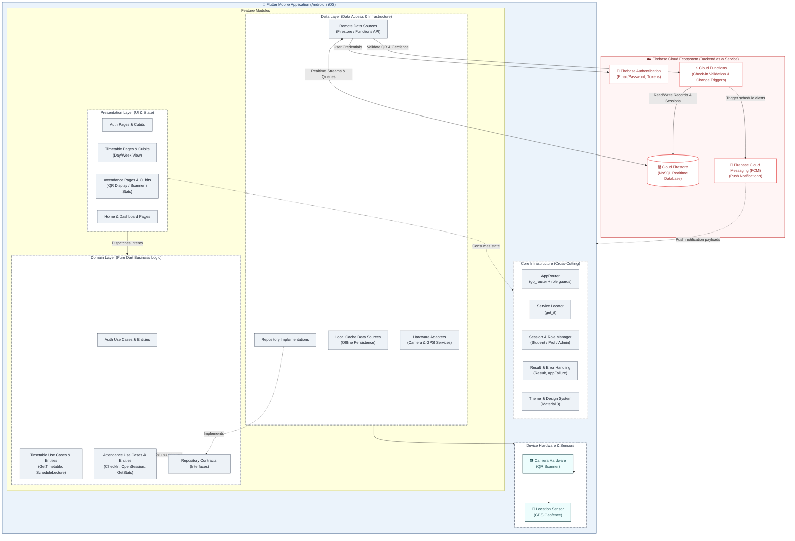
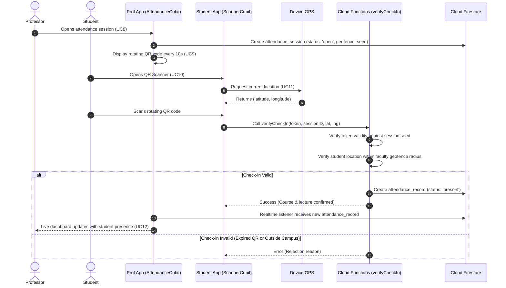
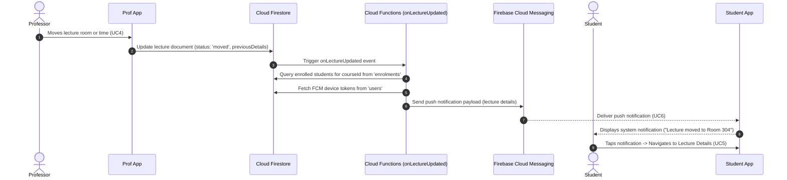

# Component architecture (SCRUM-22)

Flutter client (layers described in [the architecture](../architecture.md))
and Firebase backend. PlantUML source:
[`component-diagram.puml`](../uml/component-diagram.puml).

## Backend

- **Firebase Auth**: accounts, sessions, password resets.
- **Cloud Firestore**: the six collections of the
  [data model](firestore-data-model.md), with real-time listeners for the
  timetable and the live attendance list. Its offline cache serves the
  timetable without network (UC7).
- **Cloud Functions** (planned):
  - `verifyCheckIn`: checks the rotating QR token and the distance between
    the student and the faculty, then writes the attendance record.
  - `onLectureUpdated`: when a lecture is moved or cancelled, notifies the
    enrolled students.
- **Cloud Messaging** (planned): push notifications for lecture changes (UC6).

On the device: the camera scans QR codes (`mobile_scanner`, UC10) and
`geolocator` gives the position for the location check (UC11).

## Check-in with rotating QR code and location (UC8 to UC11)

## Lecture change and push notification (UC4, UC6)

