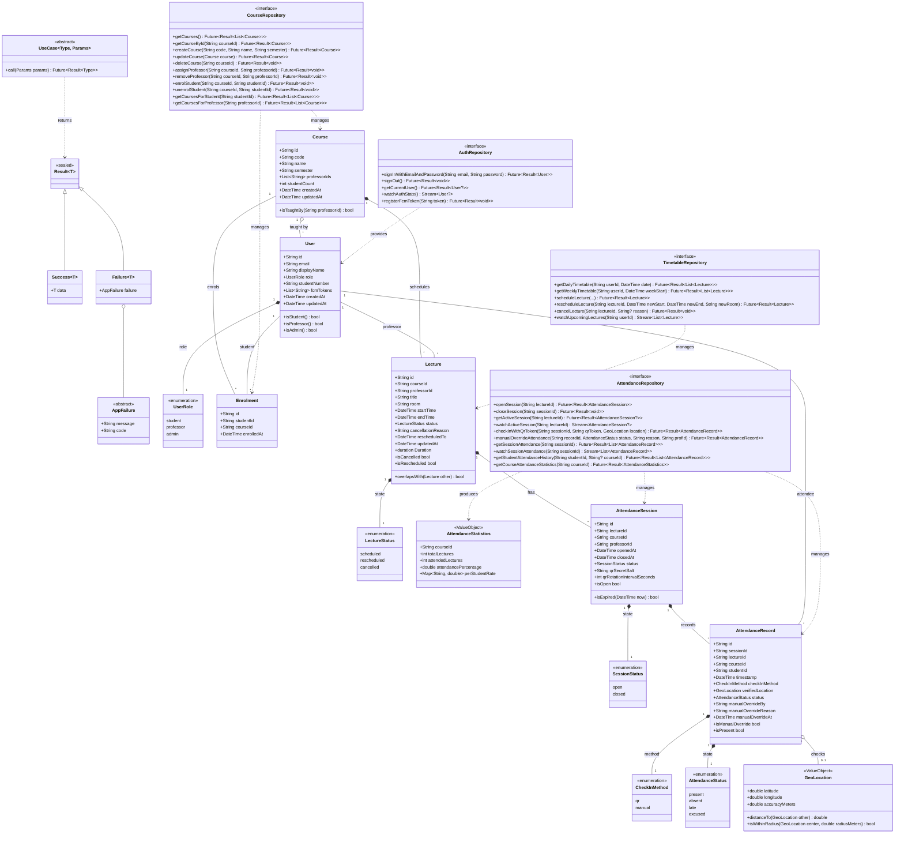

# Domain model (SCRUM-20)

Entities, value objects and repository contracts of the domain layer (pure
Dart, see [the architecture](../architecture.md)). Repositories return
`Result<T>` and never throw. PlantUML source:
[`domain-class-diagram.puml`](../uml/domain-class-diagram.puml).

## Traceability

| Domain Entity | Firestore Collection (SCRUM-23) | Component / Layer (SCRUM-22) | Primary Use Cases (SCRUM-19) |
| :--- | :--- | :--- | :--- |
| `User` | `users` | Presentation / Domain / Auth | SCRUM-25, SCRUM-28 |
| `Course` | `courses` | Presentation / Domain / Course | UC1, UC2 (SCRUM-30, SCRUM-31) |
| `Enrolment` | `enrolments` | Data / Domain / Course | UC2 (SCRUM-31) |
| `Lecture` | `lectures` | Timetable Feature | UC3, UC4, UC5, UC6, UC7 (SCRUM-32 to SCRUM-36) |
| `AttendanceSession` | `attendance_sessions` | Attendance Feature | UC8, UC9 (SCRUM-37, SCRUM-38) |
| `AttendanceRecord` | `attendance_records` | Attendance Feature | UC10, UC11, UC12, UC14 (SCRUM-39 to SCRUM-44) |
| `AttendanceStatistics`| Computed Aggregate | Attendance Feature | UC13 (SCRUM-43) |
