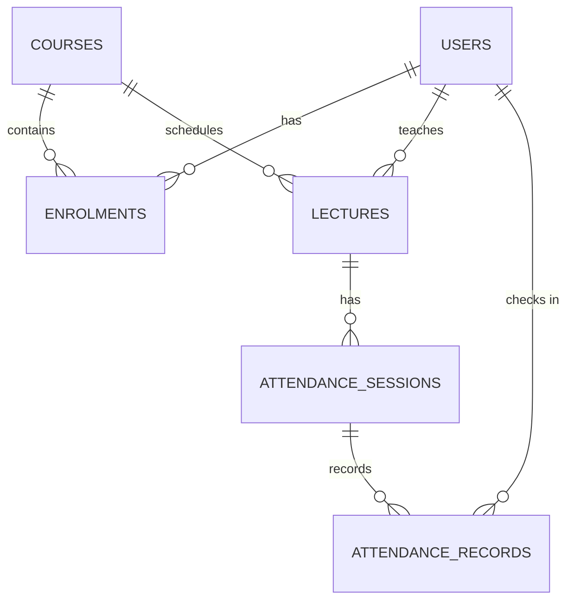

# Firestore data model (SCRUM-23)

Six root collections. Data shown in lists (names, course codes) is copied
into the documents that need it, so that a screen needs few reads.
Enrolments and attendance records use composite ids
(`{studentId}_{courseId}`, `{sessionId}_{studentId}`) so that a
duplicate is impossible.

## `users`
Represents application accounts created via Firebase Authentication.

* **Document ID**: Matches the Firebase Authentication `auth.uid`.

| Field Name | Type | Required | Description |
| :--- | :--- | :---: | :--- |
| `id` | `string` | Yes | Same as Firebase Auth UID |
| `email` | `string` | Yes | Institutional email address |
| `displayName` | `string` | Yes | Full name (Firstname Lastname) |
| `role` | `string` | Yes | Enum: `'student'`, `'professor'`, `'admin'` |
| `studentNumber` | `string` | No | Student ID number (populated if `role == 'student'`) |
| `department` | `string` | No | University department / faculty |
| `fcmTokens` | `array<string>` | No | List of FCM device tokens for push alerts (UC6) |
| `createdAt` | `timestamp` | Yes | Server timestamp of registration |
| `updatedAt` | `timestamp` | Yes | Server timestamp of last profile update |

## `courses`
Holds academic courses managed by administrators (UC1) and assigned to professors and students (UC2).

* **Document ID**: Auto-generated by Firestore (e.g. `c_mad101_2026`).

| Field Name | Type | Required | Description |
| :--- | :--- | :---: | :--- |
| `id` | `string` | Yes | Unique identifier of the course |
| `code` | `string` | Yes | Unique course code (e.g. `'CS-302'`) |
| `name` | `string` | Yes | Course title (e.g. `'Mobile Application Development'`) |
| `semester` | `string` | Yes | Semester identifier (e.g. `'2026-FALL'`) |
| `professorIds` | `array<string>` | Yes | Array of user UIDs assigned to teach this course |
| `studentCount` | `number` | Yes | Number of enrolled students (denormalized counter) |
| `description` | `string` | No | Course syllabus / brief description |
| `createdAt` | `timestamp` | Yes | Timestamp of creation |
| `updatedAt` | `timestamp` | Yes | Timestamp of modification |

## `enrolments`
Represents the relationship between students and courses (UC2).

* **Document ID**: Composite string `{studentId}_{courseId}` to guarantee uniqueness and provide $O(1)$ lookup without complex queries.

| Field Name | Type | Required | Description |
| :--- | :--- | :---: | :--- |
| `id` | `string` | Yes | `{studentId}_{courseId}` |
| `studentId` | `string` | Yes | UID of the student |
| `courseId` | `string` | Yes | ID of the course |
| `studentName` | `string` | Yes | Denormalized student display name |
| `studentEmail` | `string` | Yes | Denormalized student email |
| `courseCode` | `string` | Yes | Denormalized course code |
| `courseName` | `string` | Yes | Denormalized course title |
| `enrolledAt` | `timestamp` | Yes | Date and time of enrollment |

## `lectures`
Scheduled lecture events that populate the student and professor timetables (UC3, UC4, UC5, UC6, UC7).

* **Document ID**: Auto-generated by Firestore.

| Field Name | Type | Required | Description |
| :--- | :--- | :---: | :--- |
| `id` | `string` | Yes | Unique lecture ID |
| `courseId` | `string` | Yes | Parent course ID |
| `courseCode` | `string` | Yes | Denormalized course code |
| `courseName` | `string` | Yes | Denormalized course name |
| `professorId` | `string` | Yes | UID of the lecturing professor |
| `professorName` | `string` | Yes | Denormalized professor name |
| `title` | `string` | No | Topic/title of the lecture session |
| `room` | `string` | Yes | Room name/number (e.g. `'Amphi Turing'`, `'Lab B2'`) |
| `startTime` | `timestamp` | Yes | Lecture starting date & time |
| `endTime` | `timestamp` | Yes | Lecture ending date & time |
| `status` | `string` | Yes | Enum: `'scheduled'`, `'moved'`, `'cancelled'` |
| `cancellationReason` | `string` | No | Explanation if cancelled (UC4) |
| `previousDetails` | `map` | No | If moved: `{ "room": "...", "startTime": ..., "endTime": ... }` |
| `createdAt` | `timestamp` | Yes | Creation timestamp |
| `updatedAt` | `timestamp` | Yes | Modification timestamp |

## `attendance_sessions`
Created when a professor opens attendance for a specific lecture (UC8, UC9, UC11).

* **Document ID**: Auto-generated by Firestore.

| Field Name | Type | Required | Description |
| :--- | :--- | :---: | :--- |
| `id` | `string` | Yes | Unique attendance session ID |
| `lectureId` | `string` | Yes | Associated lecture ID |
| `courseId` | `string` | Yes | Associated course ID |
| `professorId` | `string` | Yes | UID of the professor who opened the session |
| `status` | `string` | Yes | Enum: `'open'`, `'closed'` |
| `openedAt` | `timestamp` | Yes | Timestamp when opened |
| `closedAt` | `timestamp` | No | Timestamp when closed |
| `tokenRotationIntervalSeconds` | `number` | Yes | Token validity window (default: `10`) |
| `geofence` | `map` | Yes | Campus coordinates & allowed radius (UC11): `{ latitude: 45.8150, longitude: 15.9819, radiusMeters: 250 }` |

**Subdocument `attendance_sessions/{sessionId}/private/secret`** (SCRUM-29):
enrolled students can read the session document, so the QR seed is kept apart,
readable only by the course's professors and Cloud Functions.

| Field Name | Type | Required | Description |
| :--- | :--- | :---: | :--- |
| `sessionSecret` | `string` | Yes | Cryptographic seed used by Cloud Functions / App to generate & verify rotating QR tokens every 10s (UC9) |

## `attendance_records`
Individual check-in entries logged when a student scans the QR code or when a professor manually overrides attendance (UC10, UC11, UC12, UC13, UC14).

* **Document ID**: Composite `{sessionId}_{studentId}` to strictly enforce one check-in record per student per session at the database level.

| Field Name | Type | Required | Description |
| :--- | :--- | :---: | :--- |
| `id` | `string` | Yes | `{sessionId}_{studentId}` |
| `sessionId` | `string` | Yes | Parent `attendance_sessions` ID |
| `lectureId` | `string` | Yes | Associated lecture ID |
| `courseId` | `string` | Yes | Associated course ID |
| `studentId` | `string` | Yes | UID of the student |
| `studentName` | `string` | Yes | Denormalized student display name |
| `studentEmail` | `string` | Yes | Denormalized student email |
| `status` | `string` | Yes | Enum: `'present'`, `'absent'`, `'late'` |
| `checkInMethod` | `string` | Yes | Enum: `'qr_code'`, `'manual_professor'` |
| `checkInTime` | `timestamp` | Yes | Timestamp of check-in |
| `studentLocation` | `map` | No | Geolocation captured during scan: `{ latitude: 45.8151, longitude: 15.9818, distanceMeters: 45.2 }` |
| `isManualCorrection` | `boolean` | Yes | Flag indicating whether a professor manually updated this record (UC12) |
| `correctedByProfessorId` | `string` | No | Professor UID who modified the status |
| `correctedAt` | `timestamp` | No | Timestamp of the correction |

## Main queries

Composite indexes are in [`firestore.indexes.json`](../../firestore.indexes.json).

| Use | Query |
| --- | --- |
| Student timetable (UC5, UC7) | `enrolments` where `studentId == uid`, then `lectures` where `courseId in [...]` and `startTime` in range, ordered by `startTime` |
| Professor timetable | `lectures` where `professorId == uid` and `startTime` in range |
| Lecture change notification (UC6) | `enrolments` where `courseId == lecture.courseId` (Cloud Function) |
| Live attendance list (UC12) | `attendance_records` where `courseId` and `sessionId`, ordered by `checkInTime` desc |
| Course statistics (UC13) | `attendance_records` where `courseId` and `status == 'present'` |
| Own attendance (UC14) | `attendance_records` where `studentId == uid` and `courseId`, ordered by `checkInTime` desc |

## Security rules

Enforced by [`firestore.rules`](../../firestore.rules) (SCRUM-29) and tested
against the emulator with `npm run test:rules`. Everything not listed is
denied. The role is read from `users/{uid}.role`; Cloud Functions (Admin SDK)
bypass the rules.

| Collection | Student | Professor | Admin |
| :--- | :--- | :--- | :--- |
| `users` | Read own; update own `fcmTokens` only | Read own; update own `fcmTokens` only | Full, except changing own role |
| `courses` | Read enrolled (by id) | Read taught (`array-contains` query) | Full |
| `enrolments` | Read own | Read for taught courses | Full (student/course of an enrolment immutable) |
| `lectures` | Read for enrolled courses | Read/create/update/delete for taught courses | Read |
| `attendance_sessions` | Read for enrolled courses | Read/create/update/delete for taught courses | Read |
| `…/private/secret` | — | Read/write for taught courses | — |
| `attendance_records` | Read own | Read for taught courses; manual create/correction (`isManualCorrection = true`) | Read |

Rules are not filters: queries must carry the constraint that the rules
check (`courseId` for enrolled/taught courses, `professorId == uid`,
`studentId == uid`). QR check-ins are created only by the `verifyCheckIn`
Cloud Function.
