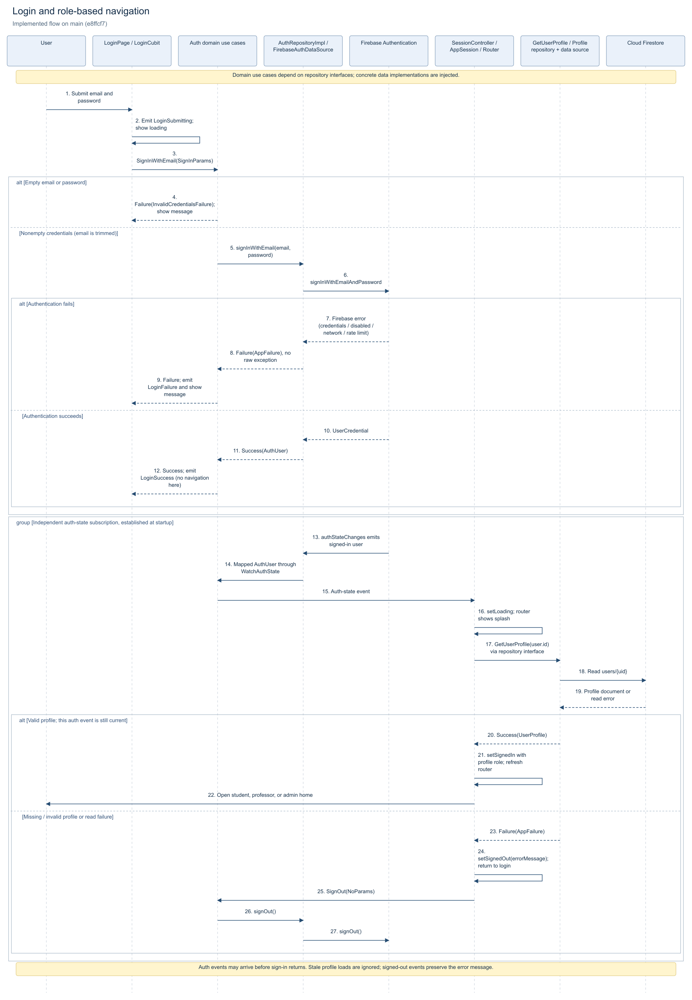
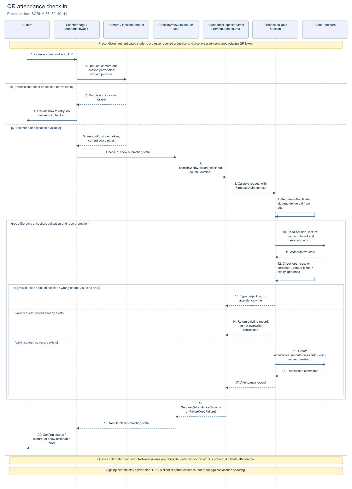
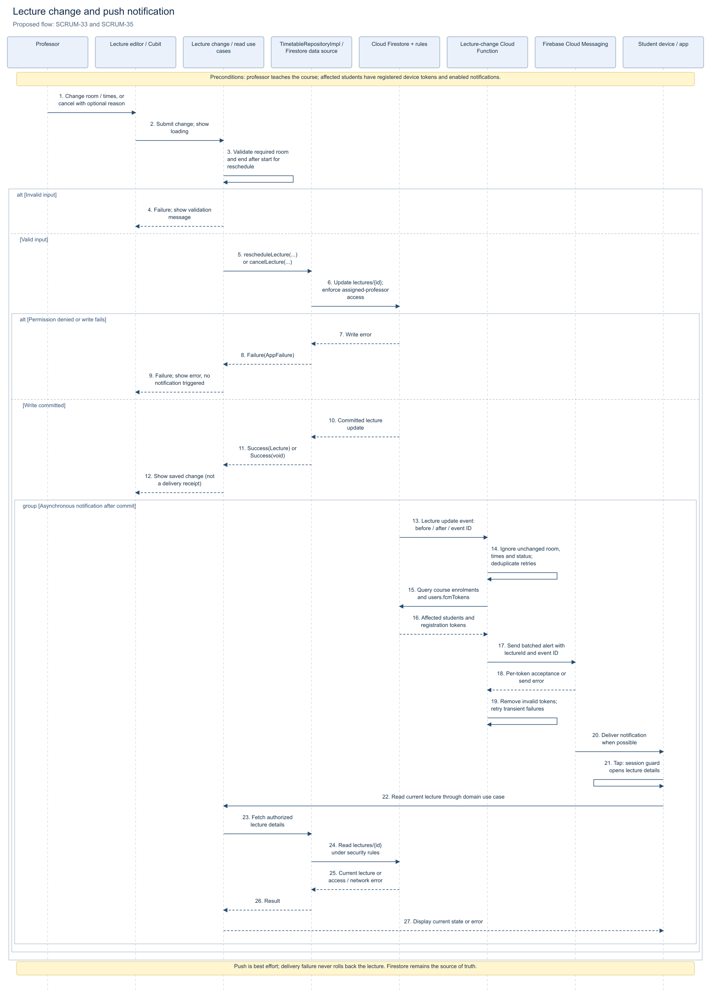

# Key-flow sequence diagrams (SCRUM-21)

Three UML sequence diagrams trace UI, domain use cases, repository implementations,
data sources and Firebase. Solid arrows are calls/events; dashed arrows are results.
`alt` frames show alternatives. Lifelines that combine related components are
explicitly labeled; they do not imply the domain imports Firebase.

## Login and role-based navigation

[PlantUML source](login.puml) · [Scalable diagram](login.svg)

This diagram follows main commit `e8ffcf7`, specifically `LoginCubit`,
`SignInWithEmail`, `AuthRepositoryImpl`, `FirebaseAuthDataSource`,
`SessionController`, `GetUserProfile` and the session-based router.
Sign-in success does not navigate directly: a separate auth-state subscription
loads `users/{uid}`, updates `AppSession`, and redirects according to the profile
role. The subscription also restores sessions at startup. Profile loads from
superseded auth events are ignored. A profile failure signs the app out and
attempts Firebase sign-out; a sign-out failure is not retried in a loop.

Cases covered: loading, empty input, invalid credentials, disabled user, rate
limiting, network error, valid profile, and missing/invalid/inaccessible profile.
The diagram's auth event section is independent of the sign-in return ordering.

## QR attendance check-in

[PlantUML source](qr-check-in.puml) · [Scalable diagram](qr-check-in.svg)

This is a proposed design for SCRUM-38 to SCRUM-41, not implemented functionality.
The domain repository contract follows SCRUM-20. A callable Cloud Function
validates authentication, student role, enrolment, session state, token signature
and expiry, and location before creating attendance. Identity comes from the
authenticated context, never a submitted student ID. Check-in needs online
confirmation; camera/location failures stop before submission.

Validation and creation use a transaction so concurrent check-ins cannot create
duplicates or race a session closure. The proposed duplicate behavior returns
the existing record without overwriting professor corrections. The deterministic
record ID is `{sessionId}_{studentId}`, as in SCRUM-23. Invalid requests do not
write records; network failures may be retried with the same identity.

**Security clarification:** the model's `sessionSecret` / `qrSecretSalt` must
remain backend-only, not in a student-readable document or a client entity.
Use a server-only secret store/document and return signed QR tokens. Current
SCRUM-29 rules already isolate `attendance_sessions/{sessionId}/private/secret`
from students, but allow assigned professors to read/write it. Backend-only
signing is a proposed tightening; the older Confluence model and client entity
must be reconciled with that choice. The rules reserve QR writes for the proposed
`verifyCheckIn` function, which is not present on main yet. Raw GPS
coordinates are client-reported; checking a geofence alone cannot prevent spoofing.
Signing-secret storage, location accuracy thresholds, and late-arrival policy
remain implementation decisions, not requirements invented by this diagram.

## Lecture change and push notification

[PlantUML source](lecture-change.puml) · [Scalable diagram](lecture-change.svg)

This proposed design covers UC4/UC6 (SCRUM-33/SCRUM-35). A professor changes a
lecture through a domain use case and repository. Firestore rules enforce course
assignment and valid writes. Only a committed change triggers a Cloud Function;
the UI confirms the saved lecture, not delivery of a notification.

The function compares room, times and status, finds affected students through
`enrolments`, and resolves their `users.fcmTokens`. Token registration/refresh and
notification permission are prerequisites outside this flow. No tokens means no
push, while the timetable remains available. Invalid tokens are removed and
transient send failures retried. Event IDs support duplicate suppression, but
Firestore and FCM do not form one transaction: exactly-once delivery is not
assumed. Delivery failure never rolls back a saved lecture. Notification taps
pass through session/role guards and re-read the authorized current lecture.

The SCRUM-20 domain enum uses `rescheduled`; SCRUM-23 uses the stored value
`moved`. A data-layer mapper must reconcile this when implemented. The diagram
uses behavior names rather than silently choosing a new persistence schema.

## Sources and publication

- Published diagrams: [Login](https://uniconnecterasmus.atlassian.net/wiki/spaces/SD/pages/8617986),
  [QR check-in](https://uniconnecterasmus.atlassian.net/wiki/spaces/SD/pages/8650753),
  [Lecture change](https://uniconnecterasmus.atlassian.net/wiki/spaces/SD/pages/8683521).
- [SCRUM-21](https://uniconnecterasmus.atlassian.net/browse/SCRUM-21)
- [Domain model (SCRUM-20)](https://uniconnecterasmus.atlassian.net/wiki/spaces/SD/pages/8159236)
- [Use cases](../../specs/use-cases.md)
- [Firestore model](../../specs/firestore-data-model.md)
- [Architecture](../../architecture.md)

## Editing and regeneration

The sequence definitions in `generate.mjs` generate both `.puml` and `.svg`
without dependencies: `node docs/uml/sequences/generate.mjs`.
Edit those definitions rather than the generated files. Render the SVGs to PNG
with an SVG rasterizer (the checked-in PNGs use Sharp at original size).
The generator checks participant references and balanced alternative/group frames.
PNG and SVG outputs were visually reviewed; PlantUML files are editable exports,
not the renderer used for these previews.
